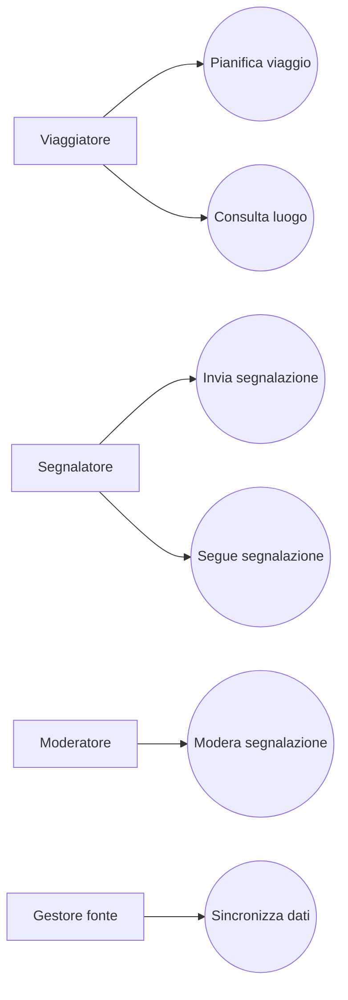
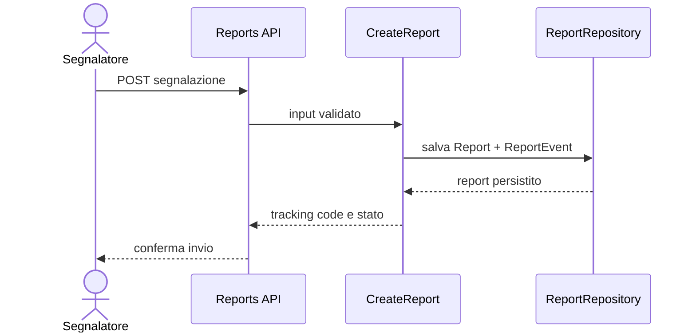

# Documento di Analisi dei Requisiti — RAD

> Bozza starter v0.2 — 15 novembre 2026
> Stato: da validare con utenti, enti di trasporto e responsabili dei dati.  
> Struttura derivata dal [template convertito in Markdown](template.md); file sorgente e risorse sono in `templates/` e `assets/`.

## 1. Introduzione

### 1.1 Scopo e ambito

La web app aiuta le persone con disabilità a pianificare spostamenti urbani, consultare accessibilità di stazioni, fermate e mezzi, e segnalare barriere o guasti. Il pilota geografico, i profili di utenti coinvolti e le fonti disponibili devono ancora essere concordati.

### 1.2 Obiettivi e criteri di successo

- Consentire di trovare e confrontare percorsi, rendendo visibili barriere note e tratti non verificati.
- Presentare stato, fonte e freschezza dei dati di accessibilità.
- Consentire l’invio e il tracciamento di segnalazioni.
- Consentire ai moderatori di gestire segnalazioni senza perdere lo storico.
- Rendere i flussi essenziali utilizzabili da tastiera e screen reader.

Il successo sarà verificato con prove d’uso sul campo e con utenti con disabilità. Metriche e soglie quantitative sono da definire per il pilota.

### 1.3 Definizioni, acronimi e abbreviazioni

| Termine | Definizione |
|---|---|
| RAD | Requirements Analysis Document / Documento di Analisi dei Requisiti |
| SDD | Software Design Description / Documento di Progettazione del Software |
| FR | Requisito funzionale |
| NFR | Requisito non funzionale |
| Dato scaduto | Dato oltre la validità definita per la relativa fonte/tipologia |
| Tratto non verificato | Tratto per cui non esistono dati sufficienti e validi per decidere la compatibilità |
| Tracking code | Codice non enumerabile usato per consultare lo stato di una segnalazione |

### 1.4 Riferimenti

- Piano tecnico di mobilità urbana accessibile fornito dal committente.
- [Template RAD/SDD convertito](template.md).
- OpenAPI e policy privacy/sicurezza: da definire durante progettazione e implementazione.

### 1.5 Panoramica del sistema

Il sistema comprende un frontend web responsive, API REST Java, database geospaziale, integrazioni con fonti ufficiali e provider di routing, processi asincroni, storage per immagini e strumenti di moderazione/operatività.

## 2. Sistema corrente

Il progetto è greenfield. Non è stato fornito un sistema esistente da descrivere o migrare. Prima del pilota vanno censiti i servizi già usati da operatori e persone con disabilità, i dataset disponibili e i flussi correnti di segnalazione.

## 3. Sistema proposto

### 3.1 Panoramica e obiettivi del sistema

La consultazione pubblica offre ricerca per area, dettagli di accessibilità e pianificazione di percorsi alternativi. Il sistema distingue esplicitamente informazione affidabile, informazione negativa, dato sconosciuto e dato scaduto. Le segnalazioni seguono un ciclo moderato e mantengono uno storico append-only.

### 3.2 Requisiti funzionali

| ID | Responsabile dell’azione | Azione richiesta | Priorità |
|---|---|---|---|
| FR-01 | Sistema | Mostrare luoghi e informazioni di accessibilità per l’area richiesta. | Must |
| FR-02 | Sistema | Mostrare per ogni caratteristica stato, fonte, aggiornamento e validità. | Must |
| FR-03 | Sistema | Classificare come sconosciuti i dati assenti o scaduti, senza inferire accessibilità. | Must |
| FR-04 | Utente e sistema | Acquisire origine, destinazione ed esigenze; calcolare e restituire percorsi alternativi. | Must |
| FR-05 | Sistema | Distinguere nei percorsi barriere note, tratti compatibili e tratti non verificati. | Must |
| FR-06 | Utente e sistema | Consentire la selezione di un luogo e mostrare dettagli di accessibilità e provenienza. | Must |
| FR-07 | Segnalatore | Inserire luogo, categoria, descrizione e data; allegare facoltativamente una foto. | Must |
| FR-08 | Sistema | Generare e restituire un codice di tracking per consultare lo stato della segnalazione. | Must |
| FR-09 | Moderatore e sistema | Consentire conferma, rifiuto, risoluzione o unione di duplicati; registrare ogni decisione. | Must |
| FR-10 | Adattatore dati | Importare dati ufficiali e registrare versione, esito e timestamp della sincronizzazione. | Should |
| FR-11 | Sistema | Invalidare la cache dell’area interessata quando riceve un aggiornamento urgente. | Should |
| FR-12 | Sistema | Inviare notifiche secondo preferenze, autorizzazioni e consensi configurati. | Could |

### 3.3 Requisiti non funzionali

| ID | Qualità | Azione richiesta | Criterio/nota |
|---|---|---|---|
| NFR-01 | Accessibilità | Consentire di completare i flussi essenziali da tastiera e con screen reader. | Verificare navigazione, focus, etichette e annunci. |
| NFR-02 | Accessibilità | Fornire una vista testuale equivalente alle informazioni presentate sulla mappa. | Luoghi, percorsi e stati consultabili senza mappa. |
| NFR-03 | Accessibilità | Verificare contrasto e fruibilità con zoom. | Standard e livello di conformità da concordare. |
| NFR-04 | Privacy | Minimizzare i dati personali e separare identità e segnalazioni pubbliche. | Definire finalità, accessi, conservazione e cancellazione prima del lancio. |
| NFR-05 | Sicurezza | Proteggere le comunicazioni con TLS e le funzioni riservate con ruoli. | Autorizzare ogni operazione moderativa lato server. |
| NFR-06 | Sicurezza | Applicare rate limiting, validazione server-side e protezione da injection agli endpoint. | Rifiutare input non validi senza effetti parziali. |
| NFR-07 | Sicurezza | Controllare gli upload per tipo, dimensione e contenuto prima dell’uso o pubblicazione. | Applicare scansione e accesso controllato. |
| NFR-08 | Affidabilità dati | Esporre provenienza e freschezza e applicare scadenze per fonte e tipo di dato. | Dati scaduti o assenti devono risultare sconosciuti. |
| NFR-09 | Operatività | Produrre log strutturati senza dati sensibili e metriche operative. | Monitorare disponibilità, latenza, sincronizzazioni e coda moderazione. |
| NFR-10 | Continuità | Configurare allarmi e backup automatici e svolgere prove di ripristino. | Definire obiettivi di ripristino prima del lancio. |
| NFR-11 | Performance | Misurare e mantenere entro soglie concordate la latenza API e il caricamento delle viste principali. | Definire target p95, concorrenza e dataset del pilota; misurare in staging e produzione. |
| NFR-12 | Compatibilità | Versionare le API e applicare migrazioni compatibili con le versioni applicative in distribuzione. | Supportare rilasci progressivi. |

### 3.4 Vincoli (pseudo-requisiti)

- Usare Java LTS e Spring Boot per API e worker.
- Usare PostgreSQL con PostGIS, migrazioni versionate e storage compatibile S3 per le immagini.
- Separare frontend, casi d’uso, dominio e adattatori; documentare API versionate con OpenAPI.
- La consultazione è pubblica; invio e moderazione applicano policy di autenticazione e ruolo ancora da definire.
- Ogni proprietà di accessibilità deve avere provenienza e validità; dato assente o scaduto è sconosciuto.
- Foto e dati personali sono soggetti a consenso, accesso controllato, conservazione limitata e cancellazione secondo policy da concordare.

### 3.5 Modelli del sistema

#### Utenti del sistema

| Utente/ruolo | Obiettivi | Contesto |
|---|---|---|
| Viaggiatore | Consultare luoghi e pianificare un viaggio secondo le proprie esigenze. | Web responsive, anche con tecnologie assistive. |
| Segnalatore | Inviare una barriera o un guasto e seguirne lo stato. | Pubblico; autenticazione e possibilità di invio anonimo da definire. |
| Moderatore | Valutare segnalazioni e gestire duplicati. | Area riservata, autenticazione e ruolo richiesti. |
| Gestore fonte | Mantenere configurazione e qualità delle sincronizzazioni. | Ruolo operativo da definire. |
| Amministratore tecnico | Gestire configurazione, sicurezza e operatività. | Accesso privilegiato e audit. |

#### Scenari

1. **Viaggio con esigenze selezionate:** una persona imposta origine, destinazione e vincoli; confronta percorsi e nota i segmenti non verificati.
2. **Verifica di una fermata:** una persona apre un luogo e consulta ascensori, rampe, accessi, annunci, fonte e data.
3. **Guasto temporaneo:** una persona invia una segnalazione con posizione e data; riceve il codice di tracking.
4. **Moderazione di un duplicato:** un moderatore collega una nuova segnalazione a una precedente e conserva entrambe le decisioni nello storico.

### 3.6 Modello dei casi d’uso

#### Diagramma globale

#### Specifiche dei casi d’uso

| ID e caso d’uso | Attore | Precondizioni | Postcondizioni |
|---|---|---|---|
| UC-01 Pianificare viaggio | Viaggiatore | Origine e destinazione specificate; esigenze valide. Non è richiesta autenticazione per la consultazione. | Restituiti zero o più percorsi con tempi, cambi e stato di verifica. Fonte/freschezza sono esposte quando disponibili; dati assenti/scaduti non risultano accessibili. |
| UC-02 Consultare luogo | Viaggiatore | Luogo identificabile per ID o selezione geografica; parametri validi. | Dettaglio e caratteristiche note sono mostrati con fonte e validità. Dati assenti/scaduti sono indicati come sconosciuti; nessuna modifica ai dati. |
| UC-03 Inviare segnalazione | Segnalatore | Campi obbligatori validi; upload, rate limit, autorizzazione e consenso conformi alla policy. | Segnalazione ed evento iniziale persistiti; codice di tracking restituito. In errore non rimane una segnalazione parziale. |
| UC-04 Seguire segnalazione | Segnalatore | Codice di tracking valido e presentato dal richiedente. | È mostrato solo lo stato consentito; identità e dettagli riservati non sono esposti; nessuna modifica al report. |
| UC-05 Moderare segnalazione | Moderatore | Autenticato e autorizzato; report esistente; transizione valida; motivazione richiesta presente. | Stato ed evento append-only aggiornati nella stessa transazione, con attore e timestamp. Transizione non valida: nessuna modifica. |

### 3.7 Modello degli oggetti

#### Entità

- `Place`: luogo/fermata/stazione con identificativo, nome, tipo e geometria.
- `AccessibilityFeature`: tipo, stato esplicito, fonte, timestamp e validità associati a un luogo.
- `Report`: luogo/geometria, categoria, descrizione, stato, date e riferimento protetto per tracking.
- `ReportEvent`: evento append-only con attore, timestamp, decisione e riferimento a eventuale duplicato.
- `SourceSync`: fonte, versione, esito, timestamp e controlli qualità.
- `UserAccount`: identità e ruoli; i dati identificativi sono separati dai contenuti pubblici.

#### Boundary e control (bozza)

- **Boundary:** API luoghi/accessibilità, API percorsi, API segnalazioni, API moderazione, interfaccia web e gateway upload.
- **Control/casi d’uso:** `PlanRoute`, `GetPlaceAccessibility`, `CreateReport`, `TrackReport`, `ModerateReport`, `SynchronizeSource`.

#### Diagramma classi concettuale

### 3.8 Modelli dinamici

#### Sequenza: invio segnalazione

Le transizioni ammesse di moderazione e gli stati completi del report sono da definire nel modello di dominio.

## 4. Interfaccia utente

Le viste iniziali sono: ricerca e preferenze di viaggio; risultati e alternative; mappa affiancata da elenco; dettaglio luogo; form segnalazione; pagina tracking; coda e dettaglio moderazione. Ogni informazione cartografica deve avere alternativa testuale e le interazioni devono supportare tastiera e screen reader. Wireframe e prototipo sono da realizzare e validare.

### 4.1 Descrizione del prototipo realizzato

**Stato:** non ancora realizzato. Da documentare al completamento.

| Aspetto | Da specificare |
|---|---|
| Scopo/ruolo/interfaccia/implementazione | Da definire |
| Modo d’uso | Statico, dinamico o interattivo: da definire |
| Fedeltà | Bassa o alta: da definire |
| Completezza funzionale | Orizzontale o verticale: da definire |
| Durata | Usa e getta o evolutivo: da definire |

### 4.2 Test di usabilità

**Stato:** pianificato, non eseguito.

- **Obiettivi:** verificare pianificazione, interpretazione della freschezza, consultazione del luogo, invio/tracking e moderazione con tecnologie assistive.
- **Metodologia:** reclutare persone con disabilità; definire campione, profili, compiti, ambiente, strumenti, osservatori e consenso prima delle sessioni.
- **Misure:** completamento dei compiti, errori, tempo, comprensione di dato sconosciuto e feedback qualitativo. Numeri e soglie da concordare.
- **Analisi e raccomandazioni:** registrare problemi, gravità, evidenze e interventi prioritizzati dopo i test.

### 4.3 Valutazione dell’usabilità

Da eseguire sul prototipo. Valutare i principi di usabilità concordati, documentando metodo, partecipanti, risultati e limiti; eventuali punteggi non sono disponibili in questa bozza.

## 5. Allegati

- [Template DOCX originale](../templates/template.docx), convertito in [Markdown](template.md).
- Immagini e parti estratte: [inventario degli asset](../assets/template_assets/ASSETS.md).
- Diagrammi in questa bozza: sorgenti Mermaid inline.

## 6. Glossario

| Termine | Definizione |
|---|---|
| Dato valido | Informazione non scaduta secondo la policy della relativa fonte. |
| Sconosciuto | Stato usato quando manca un dato valido sufficiente a determinare l’accessibilità. |
| Moderazione | Processo di valutazione e decisione su una segnalazione. |
| Duplicato | Segnalazione riferita a un caso già registrato e collegata senza cancellare la cronologia. |
