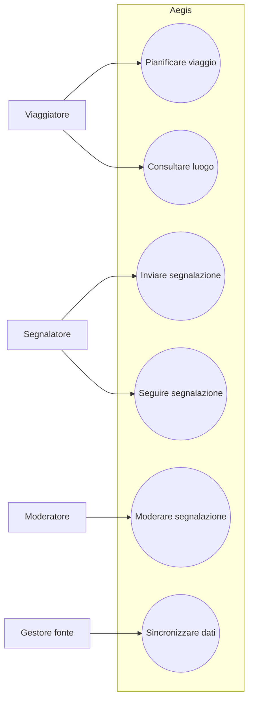
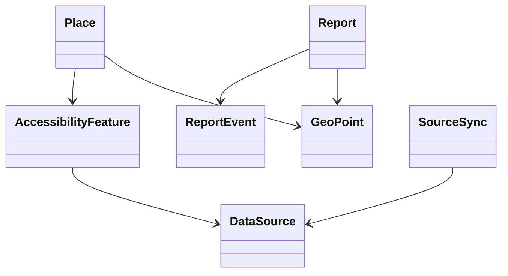
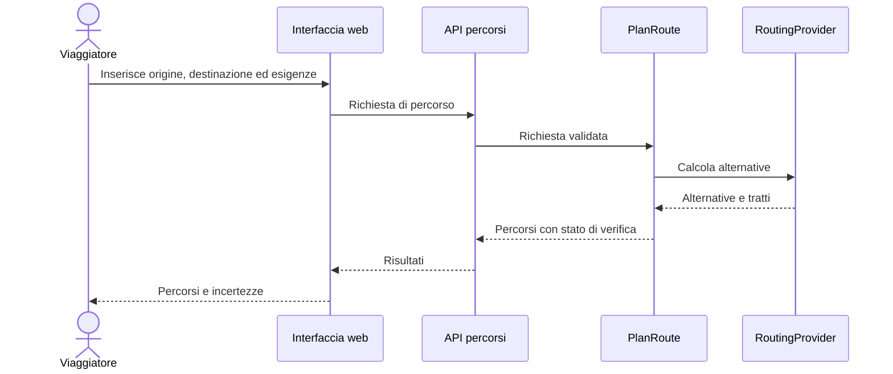
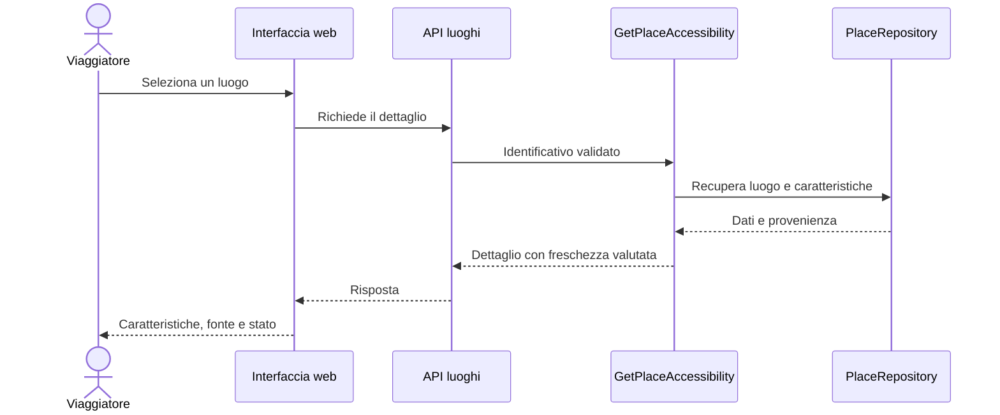
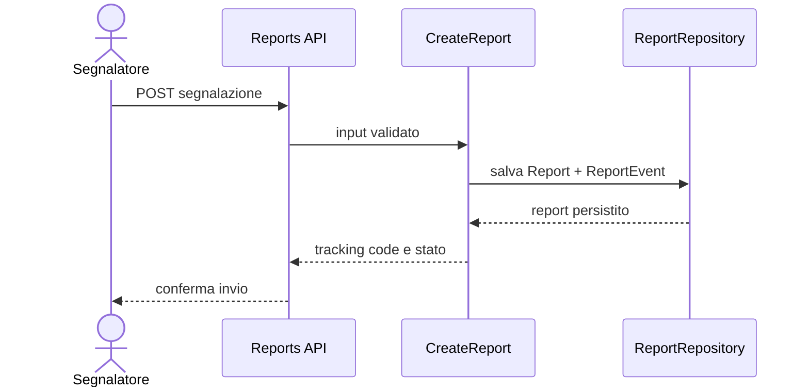
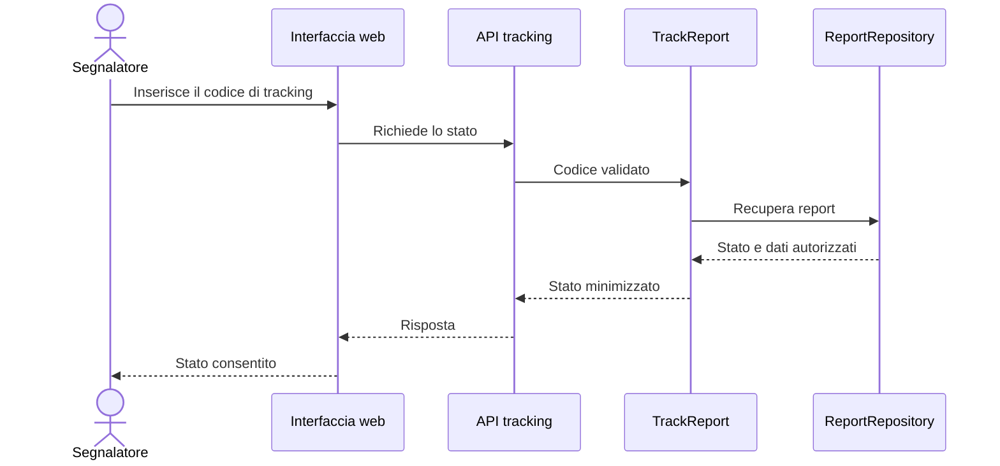
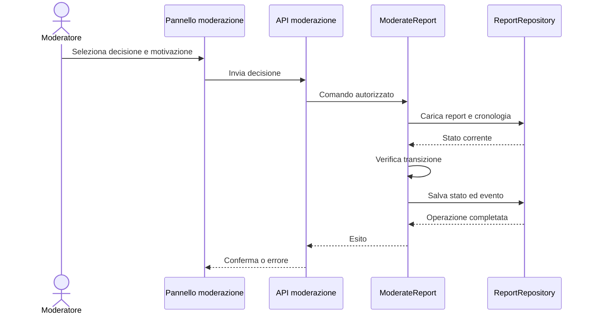

# RAD

## Documento di Analisi dei Requisiti

| Dato | Valore |
|---|---|
| Progetto | Aegis — mobilità urbana accessibile |
| Corso | Da compilare |
| Docenti | Da compilare |
| Candidati | Da compilare |
| Anno accademico | Da confermare |

Bozza aggiornata il 15 novembre 2026. I requisiti sono da convalidare con persone con disabilità, enti di trasporto e responsabili delle fonti dati.

## SOMMARIO

| Sezione | Contenuto |
|---|---|
| [Introduzione](#introduzione) | [Scopo del sistema](#11-scopo-del-sistema), [area di dominio](#12-area-di-dominio) |
| [Sistema corrente](#sistema-corrente) | Contesto esistente |
| [Sistema proposto](#sistema-proposto) | [Panoramica](#31-panoramica), [requisiti funzionali](#32-requisiti-funzionali), [requisiti non funzionali](#33-requisiti-non-funzionali), [vincoli](#34-vincoli), [modelli di sistema](#35-modelli-di-sistema) |
| [Utenti del sistema](#351-utenti-del-sistema) | Ruoli e contesti |
| [Scenari](#352-scenari) | Flussi rappresentativi |
| [Modelli dei casi d’uso](#353-modelli-dei-casi-duso) | Diagramma globale e schede con condizioni d’ingresso e d’uscita |
| [Modello degli oggetti](#354-modello-degli-oggetti) | Entity, boundary e control |
| [Diagramma delle classi](#355-diagramma-delle-classi) | Struttura statica concettuale |
| [Diagrammi di sequenza](#356-diagrammi-di-sequenza) | Flussi principali del sistema |
| [Interfaccia utente](#interfaccia-utente) | [Prototipo](#41-descrizione-del-prototipo-realizzato), [test di usabilità](#42-test-di-usabilità), [valutazione ISO](#43-valutazione-dellusabilità-secondo-iso-9241-110) |
| [Obiettivi del test](#421-obiettivi-del-test) | Scopo della valutazione |
| [Metodologia usata](#422-metodologia-usata) | Partecipanti, compiti e misure |
| [Sintesi delle misure](#423-sintesi-delle-misure) | Risultati raccolti |
| [Analisi dei risultati](#424-analisi-dei-risultati) | Problemi osservati ed evidenze |
| [Sintesi delle interviste](#425-sintesi-delle-interviste) | Risultati qualitativi |
| [Raccomandazioni finali](#426-raccomandazioni-finali) | Interventi prioritizzati |
| [Dettaglio punteggi](#431-dettaglio-punteggi-assegnati) | Valutazione secondo ISO 9241-110 |
| [Profilo di valutazione visiva](#432-profilo-di-valutazione-visiva) | Rappresentazione dei punteggi raccolti |
| [Glossario](#glossario) | Termini e acronimi |

## INTRODUZIONE

### 1.1 SCOPO DEL SISTEMA

La web app aiuta le persone con disabilità a pianificare spostamenti urbani, consultare l’accessibilità di stazioni, fermate e mezzi e segnalare barriere o guasti. Il sistema mostra la fonte e la data di aggiornamento delle caratteristiche. Un dato assente o scaduto è sconosciuto e non viene interpretato come prova di accessibilità.

Gli obiettivi sono trovare e confrontare percorsi, consultare le caratteristiche dei luoghi, inviare e tracciare segnalazioni e permettere ai moderatori di gestirle senza perdere la cronologia. Il successo sarà valutato con prove sul campo e sessioni con persone con disabilità; area pilota, partecipanti, metriche e soglie sono da definire.

| Obiettivo | Criterio di verifica |
|---|---|
| Trovare e confrontare percorsi | Le alternative rendono visibili barriere note e tratti non verificati. |
| Consultare l’accessibilità | Ogni caratteristica mostra stato, fonte e freschezza disponibili. |
| Inviare e tracciare segnalazioni | L’invio restituisce un codice utilizzabile per consultare lo stato. |
| Moderare segnalazioni | Le decisioni sono gestibili senza perdere la cronologia. |
| Usare i flussi essenziali con tecnologie assistive | Le prove verificano tastiera e screen reader. |

### 1.2 AREA DI DOMINIO

Il dominio comprende pianificazione della mobilità urbana, dati geospaziali di trasporto pubblico, accessibilità di luoghi e infrastrutture e raccolta moderata di segnalazioni. Il pilota geografico, i servizi di trasporto coinvolti e le fonti disponibili devono ancora essere concordati.

## SISTEMA CORRENTE

Il progetto è greenfield. Non è stato fornito un sistema esistente da descrivere o migrare. Prima del pilota vanno censiti i servizi già usati da operatori e persone con disabilità, i dataset disponibili e i flussi correnti di segnalazione.

## SISTEMA PROPOSTO

### 3.1 PANORAMICA

La consultazione pubblica offre ricerca per area, dettagli di accessibilità e pianificazione di percorsi alternativi. Il sistema distingue esplicitamente informazione affidabile, informazione negativa, dato sconosciuto e dato scaduto. Le segnalazioni seguono un ciclo moderato e mantengono uno storico append-only.

### 3.2 REQUISITI FUNZIONALI

| ID | Responsabile dell’azione | Azione richiesta | Priorità |
|---|---|---|---|
| FR-01 | Sistema | Mostrare luoghi e informazioni di accessibilità per l’area richiesta. | Must |
| FR-02 | Sistema | Mostrare per ogni caratteristica stato, fonte, aggiornamento e validità. | Must |
| FR-03 | Sistema | Classificare come sconosciuti i dati assenti o scaduti, senza inferire accessibilità. | Must |
| FR-04 | Utente e sistema | Acquisire origine, destinazione ed esigenze; calcolare e restituire percorsi alternativi. | Must |
| FR-05 | Sistema | Distinguere nei percorsi barriere note, tratti compatibili e tratti non verificati. | Must |
| FR-06 | Utente e sistema | Consentire la selezione di un luogo e mostrare dettagli di accessibilità e provenienza. | Must |
| FR-07 | Segnalatore | Inserire luogo, categoria, descrizione e data; allegare facoltativamente una foto. | Must |
| FR-08 | Sistema | Generare e restituire un codice di tracking per consultare lo stato della segnalazione. | Must |
| FR-09 | Moderatore e sistema | Consentire conferma, rifiuto, risoluzione o unione di duplicati; registrare ogni decisione. | Must |
| FR-10 | Adattatore dati | Importare dati ufficiali e registrare versione, esito e timestamp della sincronizzazione. | Should |
| FR-11 | Sistema | Invalidare la cache dell’area interessata quando riceve un aggiornamento urgente. | Should |
| FR-12 | Sistema | Inviare notifiche secondo preferenze, autorizzazioni e consensi configurati. | Could |

### 3.3 REQUISITI NON FUNZIONALI

| ID | Qualità | Azione richiesta | Criterio/nota |
|---|---|---|---|
| NFR-01 | Accessibilità | Consentire di completare i flussi essenziali da tastiera e con screen reader. | Verificare navigazione, focus, etichette e annunci. |
| NFR-02 | Accessibilità | Fornire una vista testuale equivalente alle informazioni presentate sulla mappa. | Luoghi, percorsi e stati consultabili senza mappa. |
| NFR-03 | Accessibilità | Verificare contrasto e fruibilità con zoom. | Standard e livello di conformità da concordare. |
| NFR-04 | Privacy | Minimizzare i dati personali e separare identità e segnalazioni pubbliche. | Definire finalità, accessi, conservazione e cancellazione prima del lancio. |
| NFR-05 | Sicurezza | Proteggere le comunicazioni con TLS e le funzioni riservate con ruoli. | Autorizzare ogni operazione moderativa lato server. |
| NFR-06 | Sicurezza | Applicare rate limiting, validazione server-side e protezione da injection agli endpoint. | Rifiutare input non validi senza effetti parziali. |
| NFR-07 | Sicurezza | Controllare gli upload per tipo, dimensione e contenuto prima dell’uso o pubblicazione. | Applicare scansione e accesso controllato. |
| NFR-08 | Affidabilità dati | Esporre provenienza e freschezza e applicare scadenze per fonte e tipo di dato. | Dati scaduti o assenti devono risultare sconosciuti. |
| NFR-09 | Operatività | Produrre log strutturati senza dati sensibili e metriche operative. | Monitorare disponibilità, latenza, sincronizzazioni e coda moderazione. |
| NFR-10 | Continuità | Configurare allarmi e backup automatici e svolgere prove di ripristino. | Definire obiettivi di ripristino prima del lancio. |
| NFR-11 | Performance | Misurare e mantenere entro soglie concordate la latenza API e il caricamento delle viste principali. | Definire target p95, concorrenza e dataset del pilota; misurare in staging e produzione. |
| NFR-12 | Compatibilità | Versionare le API e applicare migrazioni compatibili con le versioni applicative in distribuzione. | Supportare rilasci progressivi. |

### 3.4 VINCOLI

| Vincolo | Specifica e stato |
|---|---|
| Piattaforma applicativa | Usare Java LTS e Jakarta EE per API e worker; usare Jakarta Faces e Facelets per le viste server-side. Versioni e runtime sono da convalidare. |
| Persistenza e file | Usare PostgreSQL con PostGIS, migrazioni versionate e storage compatibile S3 per le immagini. |
| Struttura software | Separare frontend, casi d’uso, dominio e adattatori; documentare API versionate con OpenAPI. |
| Accesso | La consultazione è pubblica; autenticazione e ruoli per invio e moderazione sono da definire. |
| Dati di accessibilità | Ogni proprietà registra provenienza e validità; dato assente o scaduto è sconosciuto. |
| Dati personali e immagini | Applicare consenso, accesso controllato, conservazione limitata e cancellazione secondo policy da concordare. |

### 3.5 MODELLI DI SISTEMA

#### 3.5.1 UTENTI DEL SISTEMA

| Utente/ruolo | Obiettivi | Contesto |
|---|---|---|
| Viaggiatore | Consultare luoghi e pianificare un viaggio secondo le proprie esigenze. | Web responsive, anche con tecnologie assistive. |
| Segnalatore | Inviare una barriera o un guasto e seguirne lo stato. | Pubblico; autenticazione e possibilità di invio anonimo da definire. |
| Moderatore | Valutare segnalazioni e gestire duplicati. | Area riservata, autenticazione e ruolo richiesti. |
| Gestore fonte | Mantenere configurazione e qualità delle sincronizzazioni. | Ruolo operativo da definire. |
| Amministratore tecnico | Gestire configurazione, sicurezza e operatività. | Accesso privilegiato e audit. |

#### 3.5.2 SCENARI

| Nome | Attori partecipanti | Flusso degli eventi |
|---|---|---|
| Viaggio con esigenze selezionate | Viaggiatore, sistema, provider di routing | Il viaggiatore inserisce origine, destinazione ed esigenze; il sistema richiede alternative al provider; il sistema mostra tempi, cambi, barriere note e tratti non verificati. |
| Verifica di una fermata | Viaggiatore, sistema | Il viaggiatore seleziona una fermata; il sistema recupera le caratteristiche disponibili; il sistema mostra stato, fonte e validità, indicando come sconosciuti i dati assenti o scaduti. |
| Guasto temporaneo | Segnalatore, sistema | Il segnalatore inserisce luogo, categoria, descrizione e data; facoltativamente allega una foto; il sistema registra la segnalazione e restituisce il codice di tracking. |
| Moderazione di un duplicato | Moderatore, sistema | Il moderatore esamina una segnalazione e la collega al duplicato esistente; il sistema registra la decisione e conserva la cronologia precedente. |

#### 3.5.3 MODELLI DEI CASI D’USO

##### Diagramma globale

Il diagramma mostra gli attori esterni e i casi d’uso principali di consultazione, pianificazione, segnalazione, moderazione e sincronizzazione.

##### Specifiche dei casi d’uso

Il template richiede per ogni caso d’uso attori, condizioni d’ingresso e d’uscita, requisiti qualitativi e flusso degli eventi. Ogni scheda seguente usa questi campi.

| ID | Caso d’uso | Titolo | Attore principale | Descrizione |
|---|---|---|---|---|
| UC-01 | Pianificazione | Pianificare un viaggio | Viaggiatore | Inserisce origine, destinazione ed esigenze e consulta percorsi alternativi con stato di verifica. |
| UC-02 | Consultazione | Consultare un luogo | Viaggiatore | Seleziona una stazione, fermata o luogo e consulta accessibilità, fonte e freschezza. |
| UC-03 | Segnalazione | Inviare una segnalazione | Segnalatore | Comunica una barriera o un guasto, allega facoltativamente una foto e riceve un codice di tracking. |
| UC-04 | Tracking | Seguire una segnalazione | Segnalatore | Presenta il codice di tracking e consulta lo stato consentito della segnalazione. |
| UC-05 | Moderazione | Moderare una segnalazione | Moderatore | Conferma, respinge, risolve o unisce un duplicato conservando lo storico delle decisioni. |

###### UC-01 — Pianificare viaggio

| Campo | Specifica |
|---|---|
| Attori partecipanti | Viaggiatore, sistema, provider di routing. |
| Condizioni d’ingresso | Origine, destinazione ed esigenze specificate e valide; la consultazione non richiede autenticazione. |
| Condizioni d’uscita | Restituiti zero o più percorsi con tempi, cambi e stato di verifica. Fonte e freschezza sono esposte quando disponibili; dati assenti o scaduti non risultano accessibili. |
| Requisiti qualitativi | Il sistema distingue barriere note, tratti compatibili e tratti non verificati e presenta alternative disponibili. |
| Flusso degli eventi | Il viaggiatore inserisce origine, destinazione ed esigenze; il sistema valida la richiesta e la inoltra al provider; il provider restituisce le alternative; il sistema aggiunge stato di verifica e provenienza disponibili e mostra risultati e incertezze. |

###### UC-02 — Consultare luogo

| Campo | Specifica |
|---|---|
| Attori partecipanti | Viaggiatore, sistema. |
| Condizioni d’ingresso | Luogo identificabile tramite ID o selezione geografica; parametri validi. |
| Condizioni d’uscita | Dettaglio e caratteristiche note sono mostrati con fonte e validità. Dati assenti o scaduti sono indicati come sconosciuti; nessuna modifica ai dati. |
| Requisiti qualitativi | Le informazioni presentate sulla mappa sono disponibili anche in forma testuale e risultano utilizzabili da tastiera e tecnologie assistive. |
| Flusso degli eventi | Il viaggiatore seleziona o cerca un luogo; il sistema recupera dettaglio e caratteristiche; il sistema valuta la freschezza secondo la validità della fonte; il sistema mostra caratteristiche, fonte, aggiornamento e stati sconosciuti. |

###### UC-03 — Inviare segnalazione

| Campo | Specifica |
|---|---|
| Attori partecipanti | Segnalatore, sistema, servizio di storage e scansione. |
| Condizioni d’ingresso | Campi obbligatori validi; autorizzazione, rate limit, consenso e requisiti dell’eventuale upload conformi alla policy definita. |
| Condizioni d’uscita | Segnalazione ed evento iniziale persistiti; codice di tracking restituito. In caso di errore non rimane una segnalazione parziale. |
| Requisiti qualitativi | Il modulo è accessibile; i dati identificativi sono minimizzati e separati dalla segnalazione; la foto non è pubblicata prima dei controlli previsti. |
| Flusso degli eventi | Il segnalatore inserisce luogo, categoria, descrizione e data; facoltativamente allega una foto; il sistema valida i campi e controlla l’upload; il sistema registra segnalazione ed evento iniziale; il sistema restituisce il codice di tracking. |

###### UC-04 — Seguire segnalazione

| Campo | Specifica |
|---|---|
| Attori partecipanti | Segnalatore, sistema. |
| Condizioni d’ingresso | Codice di tracking valido fornito dal richiedente. |
| Condizioni d’uscita | È mostrato solo lo stato consentito; identità e dettagli riservati non sono esposti; nessuna modifica al report. |
| Requisiti qualitativi | La risposta non consente l’enumerazione delle segnalazioni e comunica lo stato in forma accessibile. |
| Flusso degli eventi | Il segnalatore inserisce il codice; il sistema lo verifica e recupera lo stato consentito; il sistema mostra lo stato senza esporre dati riservati. |

###### UC-05 — Moderare segnalazione

| Campo | Specifica |
|---|---|
| Attori partecipanti | Moderatore, sistema. |
| Condizioni d’ingresso | Moderatore autenticato e autorizzato; report esistente; transizione ammessa; motivazione presente quando richiesta. |
| Condizioni d’uscita | Stato ed evento append-only aggiornati nella stessa transazione, con attore e timestamp. Una transizione non valida non modifica i dati. |
| Requisiti qualitativi | Ogni decisione è tracciabile; gli eventi precedenti restano consultabili e non sono sovrascritti. |
| Flusso degli eventi | Il moderatore apre il report; il sistema mostra i dati e la cronologia autorizzati; il moderatore sceglie conferma, rifiuto, risoluzione o unione e inserisce la motivazione richiesta; il sistema valida la transizione e registra stato ed evento nella stessa transazione. |

#### 3.5.4 MODELLO DEGLI OGGETTI

##### Oggetti entity dei casi d’uso

| Oggetto | Responsabilità |
|---|---|
| `Place` | Rappresenta luogo, fermata o stazione con identificativo, nome, tipo e geometria. |
| `AccessibilityFeature` | Rappresenta una caratteristica con stato esplicito, fonte, timestamp e validità, associata a un luogo. |
| `Report` | Rappresenta luogo/geometria, categoria, descrizione, stato, date e riferimento protetto per tracking. |
| `ReportEvent` | Registra in modo append-only attore, timestamp, decisione e riferimento a un eventuale duplicato. |
| `SourceSync` | Registra fonte, versione, esito, timestamp e controlli di qualità. |
| `UserAccount` | Rappresenta identità e ruoli; i dati identificativi sono separati dai contenuti pubblici. |

##### Oggetti boundary dei casi d’uso

| Oggetto | Responsabilità |
|---|---|
| API luoghi/accessibilità | Riceve richieste di ricerca e dettaglio e restituisce dati con fonte e freschezza. |
| API percorsi | Riceve origine, destinazione e vincoli e restituisce alternative con incertezza esplicita. |
| API segnalazioni e tracking | Riceve segnalazioni e richieste di tracking; restituisce conferma o stato consentito. |
| API moderazione | Espone coda e operazioni di moderazione protette da autorizzazione. |
| Interfaccia web | Presenta mappa, viste testuali, percorsi, moduli e pannello di moderazione. |
| Gateway upload | Valida e inoltra le immagini al flusso controllato di storage e scansione. |

##### Oggetti control dei casi d’uso

| Oggetto | Responsabilità |
|---|---|
| `PlanRoute` | Coordina validazione della richiesta, provider e classificazione dell’incertezza. |
| `GetPlaceAccessibility` | Recupera le caratteristiche e applica le regole di freschezza. |
| `CreateReport` | Applica le regole di creazione e persiste report ed evento iniziale. |
| `TrackReport` | Recupera e limita le informazioni restituite tramite codice di tracking. |
| `ModerateReport` | Valida transizioni e persiste stato ed evento append-only in modo atomico. |
| `SynchronizeSource` | Coordina importazione, controlli di qualità e registrazione dell’esito. |

#### 3.5.5 DIAGRAMMA DELLE CLASSI

Il diagramma riassume le associazioni concettuali tra luoghi, caratteristiche di accessibilità, segnalazioni, eventi, coordinate e fonti.

#### 3.5.6 DIAGRAMMI DI SEQUENZA

I diagrammi descrivono gli scambi tra attori, boundary, casi d’uso e porte esterne per i flussi principali.

##### Pianificazione di un viaggio

Il diagramma descrive la richiesta di alternative, l’integrazione del provider e la presentazione dell’incertezza.

##### Consultazione di un luogo

Il diagramma descrive il recupero dei dati di accessibilità e la valutazione della loro freschezza.

##### Invio di una segnalazione

Il diagramma mostra lo scambio tra segnalatore, API, caso d’uso e repository durante la creazione atomica di una segnalazione.

Le transizioni ammesse di moderazione e gli stati completi del report sono da definire nel modello di dominio.

##### Tracking di una segnalazione

Il diagramma descrive la consultazione dello stato tramite codice senza esporre dati riservati.

##### Moderazione di una segnalazione

Il diagramma descrive la verifica della transizione e la registrazione atomica dello stato e dell’evento.

## INTERFACCIA UTENTE

Le viste iniziali sono: ricerca e preferenze di viaggio; risultati e alternative; mappa affiancata da elenco; dettaglio luogo; form segnalazione; pagina tracking; coda e dettaglio moderazione. Ogni informazione cartografica deve avere alternativa testuale e le interazioni devono supportare tastiera e screen reader. Wireframe e prototipo sono da realizzare e validare.

### 4.1 DESCRIZIONE DEL PROTOTIPO REALIZZATO

**Stato:** non ancora realizzato. Da documentare al completamento.

| Aspetto | Da specificare |
|---|---|
| Scopo/ruolo/interfaccia/implementazione | Da definire |
| Modo d’uso | Statico, dinamico o interattivo: da definire |
| Fedeltà | Bassa o alta: da definire |
| Completezza funzionale | Orizzontale o verticale: da definire |
| Durata | Usa e getta o evolutivo: da definire |

### 4.2 TEST DI USABILITÀ

**Stato:** pianificato, non eseguito.

#### 4.2.1 OBIETTIVI DEL TEST

Valutare se le persone riescono a pianificare un viaggio, interpretare freschezza e incertezza, consultare un luogo, inviare e seguire una segnalazione e completare i flussi con tastiera e screen reader. Obiettivi e criteri specifici sono da convalidare con i partecipanti.

#### 4.2.2 METODOLOGIA USATA

Il test non è ancora stato condotto. Numero, esperienza e caratteristiche dei partecipanti, compiti, scenari, ambiente, strumenti, modalità e durata delle sessioni sono da definire con persone con disabilità. Prima delle sessioni vanno concordati consenso, misure raccolte, ruolo degli osservatori e metodo di analisi.

#### 4.2.3 SINTESI DELLE MISURE

Risultati non disponibili perché il test non è stato eseguito. La tabella definisce le misure da raccogliere per partecipante e nel complesso.

| Compito | Tempo di esecuzione | Completamento | Errori e note |
|---|---|---|---|
| Pianificare un viaggio | Da misurare | Da misurare | Da raccogliere |
| Consultare un luogo | Da misurare | Da misurare | Da raccogliere |
| Inviare e seguire una segnalazione | Da misurare | Da misurare | Da raccogliere |
| Completare i flussi con tecnologie assistive | Da misurare | Da misurare | Da raccogliere |

Unità, soglie e modalità di aggregazione sono da concordare prima del test.

#### 4.2.4 ANALISI DEI RISULTATI

Analisi non disponibile perché il test non è stato eseguito. Per ogni partecipante e compito saranno registrati problema, gravità, screenshot o altra evidenza, reazioni e commenti e intervento richiesto. La scala di gravità è da definire nel protocollo.

#### 4.2.5 SINTESI DELLE INTERVISTE

Le interviste successive al test non sono state svolte. Le evidenze saranno sintetizzate dopo la raccolta, distinguendo osservazioni e interpretazioni.

#### 4.2.6 RACCOMANDAZIONI FINALI

Raccomandazioni non disponibili prima delle prove. Saranno ordinate per priorità e collegate ai problemi osservati.

### 4.3 VALUTAZIONE DELL’USABILITÀ SECONDO ISO 9241-110

La valutazione sarà condotta sul prototipo; partecipanti, metodo, risultati e limiti sono da documentare. Non sono stati assegnati punteggi.

#### 4.3.1 DETTAGLIO PUNTEGGI ASSEGNATI

Il modello di valutazione usa una scala da zero a quattro per ciascun principio. La tabella è predisposta senza valori, da compilare dopo le prove.

| Principio valutato | Punteggio | Evidenza e motivazione |
|---|---|---|
| Da definire nel protocollo | Non assegnato | Da raccogliere durante la valutazione |

#### 4.3.2 PROFILO DI VALUTAZIONE VISIVA

Il profilo visuale non è disponibile perché i punteggi non sono stati raccolti. Dopo la valutazione sarà generato in Markdown come diagramma descrittivo dei risultati, senza introdurre valori non osservati.

## GLOSSARIO

| Termine | Definizione |
|---|---|
| RAD | Documento di Analisi dei Requisiti. |
| SDD | Documento di Progettazione del Software. |
| FR | Requisito funzionale. |
| NFR | Requisito non funzionale. |
| API | Interfaccia di programmazione applicativa. |
| Dato valido | Informazione non scaduta secondo la policy della relativa fonte. |
| Sconosciuto | Stato usato quando manca un dato valido sufficiente per determinare l’accessibilità. |
| Tratto non verificato | Tratto senza dati sufficienti e validi per determinare la compatibilità. |
| Codice di tracking | Codice non enumerabile usato per consultare lo stato di una segnalazione. |
| Moderazione | Processo di valutazione e decisione su una segnalazione. |
| Duplicato | Segnalazione riferita a un caso già registrato e collegata senza cancellare la cronologia. |
