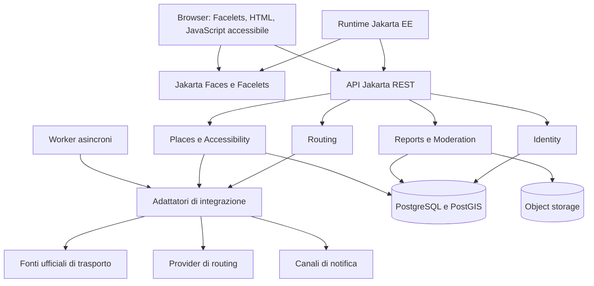

# SDD

## System Design Description

| Dato | Valore |
|---|---|
| Progetto | Aegis — mobilità urbana accessibile |
| Corso | Da compilare |
| Docenti | Da compilare |
| Candidati | Da compilare |
| Anno accademico | Da confermare |

Bozza aggiornata il 15 novembre 2026. L’architettura è iniziale; runtime Jakarta EE, fonti dati, area pilota e servizi gestiti sono da convalidare.

## SOMMARIO

| Sezione | Contenuto |
|---|---|
| [Introduzione](#introduzione) | Scopo, obiettivi, definizioni, riferimenti e panoramica |
| [Sistema corrente](#sistema-corrente) | Stato attuale e contesto |
| [Panoramica](#31-panoramica) | Architettura generale |
| [Decomposizione del sistema](#32-decomposizione-del-sistema) | Moduli e responsabilità |
| [Diagramma dei moduli](#321-diagramma-dei-moduli) | Relazioni tra componenti e dipendenze |
| [Hardware/software mapping](#33-hardwaresoftware-mapping) | Nodi e responsabilità |
| [Gestione dei dati persistenti](#34-gestione-dei-dati-persistenti) | [Struttura relazionale](#341-postgresql-e-struttura-relazionale), [object storage](#342-object-storage), [sincronizzazione](#343-meccanismi-di-sincronizzazione) |
| [Controllo accessi e sicurezza](#35-controllo-accessi-e-sicurezza) | [Identità](#351-autenticazione-e-identità), [accesso ai dati](#352-controllo-degli-accessi-ai-dati), [immagini](#353-gestione-delle-immagini), [abusi](#354-protezione-da-abusi) |
| [Flusso di controllo globale](#36-decisioni-sul-flusso-di-controllo-globale) | [Sessione](#361-gestione-della-sessione-utente), [navigazione](#362-navigazione-tra-viste), [asincronia](#363-gestione-asincrona-ed-eventi), [errori](#364-gestione-degli-errori) |
| [Condizioni limite](#37-condizioni-limite) | Routing, dati, report, moderazione, upload e sincronizzazioni |
| [Servizi del sottosistema](#servizi-del-sottosistema) | [Luoghi](#41-consultazione-e-ricerca-dei-luoghi), [accessibilità](#42-consultazione-dellaccessibilità), [percorsi](#43-pianificazione-dei-percorsi), [segnalazioni](#44-segnalazioni-e-tracking), [moderazione](#45-moderazione), [sincronizzazione](#46-sincronizzazione-e-notifiche) |
| [Glossario](#glossario) | Termini architetturali e di dominio |

## INTRODUZIONE

### 1.1 SCOPO DEL SISTEMA

Questo documento descrive l’architettura software proposta per Aegis e dettaglia i componenti, i dati, le interfacce e le decisioni operative che realizzano i requisiti definiti nel [RAD](RAD.md).

### 1.2 OBIETTIVI DI PROGETTAZIONE

| Obiettivo | Criterio architetturale |
|---|---|
| Separazione delle responsabilità | Mantenere distinti dominio, casi d’uso e adattatori. |
| Affidabilità dei dati di accessibilità | Registrare fonte e freschezza; trattare i dati assenti o scaduti come sconosciuti. |
| Sostituibilità delle integrazioni | Collegare fonti e provider tramite porte e adattatori. |
| Tracciabilità della moderazione | Conservare gli eventi decisionali in forma append-only. |
| Sicurezza e privacy | Applicare autorizzazione server-side, minimizzazione dei dati e controlli sugli upload. |
| Operatività misurabile | Registrare esiti di sincronizzazione, ritardi delle fonti, errori e stato dei processi asincroni. |

### 1.3 DEFINIZIONI, ACRONIMI E ABBREVIAZIONI

| Termine | Significato |
|---|---|
| API | Interfaccia di programmazione applicativa esposta via HTTP. |
| DTO | Oggetto di trasferimento usato ai confini applicativi. |
| SRID | Identificatore del sistema di riferimento spaziale. |
| PostGIS | Estensione spaziale di PostgreSQL. |
| Jakarta EE | Piattaforma Enterprise Java scelta come base applicativa, versione da convalidare. |
| Jakarta Faces | Tecnologia Jakarta EE per interfacce server-side basate su componenti. |
| Facelets | Tecnologia di viste XHTML usata da Jakarta Faces. |
| Jakarta REST | API Jakarta EE per risorse HTTP REST. |
| Dato sconosciuto | Informazione assente, scaduta o non valida che non permette di determinare l’accessibilità. |

### 1.4 RIFERIMENTI

| Riferimento | Uso e stato |
|---|---|
| [RAD — Documento di Analisi dei Requisiti](RAD.md) | Requisiti, attori, casi d’uso e vincoli. |
| [Template RAD/SDD convertito](template.md) | Struttura accademica di riferimento. |
| Specifica OpenAPI | Da generare e versionare insieme all’API. |
| Documentazione Jakarta EE e PostGIS | Riferimenti tecnici da associare alle versioni selezionate. |

### 1.5 PANORAMICA

Il documento descrive il contesto attuale, l’architettura proposta, la decomposizione dei moduli, la mappatura hardware/software, la persistenza, il controllo accessi, il flusso globale, le condizioni limite e i servizi dei sottosistemi.

## SISTEMA CORRENTE

Non è stato fornito un sistema software esistente. Il progetto è greenfield. Durante la definizione dell’area pilota saranno rilevati i servizi di trasporto esistenti, le fonti dati, i processi di aggiornamento e i flussi di segnalazione già in uso.

## SISTEMA PROPOSTO

### 3.1 PANORAMICA

Aegis è una web app responsive per consultare l’accessibilità di luoghi e servizi di trasporto, pianificare spostamenti e inviare segnalazioni. Le viste server-side usano Jakarta Faces e Facelets; le API REST usano Jakarta REST. La persistenza geografica usa PostgreSQL con PostGIS. Le immagini sono archiviate in object storage e le sincronizzazioni e attività lente sono svolte da worker.

La versione Jakarta EE e il runtime compatibile saranno selezionati in base ai requisiti di distribuzione e alle dipendenze del progetto. La decisione non è ancora convalidata. Provider di routing, fonti di trasporto, canali di notifica e servizi gestiti restano sostituibili e da selezionare.

Il browser riceve HTML per le viste e JSON per le API. La mappa usa una libreria cartografica client-side, ma i dati cartografici e di accessibilità provengono dall’API. La consultazione può essere pubblica; invio delle segnalazioni e moderazione applicano le policy di identità e ruolo ancora da definire.

### 3.2 DECOMPOSIZIONE DEL SISTEMA

| Modulo | Responsabilità |
|---|---|
| Places | Gestire luoghi, fermate e stazioni e fornire ricerche geospaziali. |
| Accessibility | Gestire caratteristiche, stato, fonte, timestamp e validità. |
| Routing | Validare richieste, invocare il provider e mostrare l’incertezza dei tratti. |
| Reports | Creare segnalazioni e consentire il tracking con dati minimizzati. |
| Moderation | Applicare autorizzazioni e transizioni; conservare la cronologia append-only. |
| Identity | Gestire autenticazione, ruoli e separazione dei dati identificativi. |
| Integrations | Implementare adattatori per fonti di trasporto, routing, notifiche e storage. |
| Worker | Eseguire sincronizzazioni schedulate e attività asincrone con retry idempotenti. |
| Web | Rendere viste Facelets accessibili, mappa, alternative testuali, moduli e pannello di moderazione. |

Il codice Java è organizzato per domini e separa `domain`, `application` e `adapter`. Le entità e i value object contengono invarianti; i casi d’uso orchestrano le operazioni e dipendono da porte; gli adattatori implementano accesso HTTP, persistenza e integrazioni. DTO HTTP, modello di dominio e modello di persistenza sono separati.

La struttura dei package proposta è `places`, `accessibility`, `routing`, `reports`, `identity`, `integrations` e `shared`, ciascuno articolato secondo le responsabilità effettive. La collocazione dettagliata dei componenti web e dei worker dipende dalla selezione del runtime e dal packaging applicativo.

#### 3.2.1 DIAGRAMMA DEI MODULI

Il diagramma mostra il browser e il runtime Jakarta EE, i moduli applicativi, le porte verso le dipendenze sostituibili e i sistemi persistenti.

### 3.3 HARDWARE/SOFTWARE MAPPING

| Nodo | Hardware e software | Responsabilità |
|---|---|---|
| Dispositivo client | Browser desktop o mobile e tecnologie assistive. | Renderizzare le viste, interagire con la mappa e inviare richieste HTTPS. |
| Container applicativo | Runtime Jakarta EE da selezionare; Jakarta Faces, Facelets e Jakarta REST. | Servire viste e API e coordinare i casi d’uso. |
| Container worker | Processo Java compatibile con la piattaforma scelta. | Sincronizzare fonti e gestire attività lente e retry. |
| Database | PostgreSQL con PostGIS. | Conservare entità, eventi e geometrie. |
| Object storage | Servizio compatibile con il protocollo S3; implementazione da selezionare. | Conservare immagini in modo controllato e con scadenza. |
| Ingress e distribuzione | Terminazione TLS e CDN secondo l’ambiente. | Instradare il traffico verso l’applicazione e distribuire risorse statiche. |
| Servizi esterni | Fonti ufficiali, provider di routing e canali di notifica da selezionare. | Fornire dati e capacità integrate tramite adattatori. |

In sviluppo è previsto Docker Compose con PostgreSQL/PostGIS e storage locale compatibile S3. I servizi gestiti di produzione, la topologia di rete e i requisiti delle risorse sono da definire prima del rilascio.

### 3.4 GESTIONE DEI DATI PERSISTENTI

La persistenza relazionale usa PostgreSQL e PostGIS. Le migrazioni sono versionate e devono rimanere compatibili con le versioni applicative durante il rilascio progressivo. Le entità di dominio non dipendono dal modello relazionale e sono convertite dagli adattatori di persistenza.

#### 3.4.1 POSTGRESQL E STRUTTURA RELAZIONALE

| Tabella | Contenuto e relazioni |
|---|---|
| `place` | Luogo, fermata o stazione con nome, tipo e geometria a SRID esplicito. |
| `accessibility_feature` | Tipo, stato, fonte, validità e timestamp della caratteristica; riferimento a `place`. |
| `transit_line` | Linee importate e relativi riferimenti alla fonte. |
| `transit_stop` | Fermate, geometrie e relazioni con le linee e la fonte. |
| `report` | Geometria o luogo, categoria, descrizione, stato e date; dati identificativi separati. |
| `report_event` | Eventi append-only con autore, data, decisione e riferimento a eventuale duplicato. |
| `user_account` | Riferimento d’identità e ruoli con accesso limitato. |
| `source_sync` | Fonte, versione, timestamp, esito e controlli di qualità. |

Le relazioni sono protette da chiavi esterne e vincoli. Le ricerche geografiche usano indici spaziali; ulteriori indici sono definiti in base alle query validate. Le coordinate di dominio sono rappresentate da `GeoPoint`, value object immutabile con controlli di validità.

Ogni caratteristica di accessibilità registra fonte, stato, data di aggiornamento e validità. L’assenza o la scadenza produce lo stato sconosciuto. Ogni operazione di moderazione aggiorna lo stato corrente e inserisce l’evento corrispondente nella stessa transazione; gli eventi non sono modificati né eliminati dall’applicazione ordinaria.

#### 3.4.2 OBJECT STORAGE

Le foto sono conservate fuori dal database in object storage. Prima della pubblicazione devono essere verificati tipo effettivo, dimensione e contenuto e deve essere eseguita la scansione prevista. L’accesso è controllato; la conservazione e la scadenza dipendono dalla policy privacy ancora da definire. Il database conserva riferimenti e metadati necessari, non i byte dell’immagine.

#### 3.4.3 MECCANISMI DI SINCRONIZZAZIONE

Worker asincroni importano dati di trasporto e accessibilità tramite adattatori isolati. Ogni esecuzione registra fonte, versione, timestamp, esito e controlli di qualità in `source_sync`. Le operazioni sono idempotenti o usano deduplicazione per gestire retry.

Frequenza e validità sono definite per ciascuna fonte e tipologia durante la selezione dell’area pilota. I dati oltre la validità sono esposti come sconosciuti. Un aggiornamento urgente invalida la cache dell’area interessata e rende osservabile l’esito dell’invalidazione.

### 3.5 CONTROLLO ACCESSI E SICUREZZA

Il controllo accessi è applicato lato server. Le policy di identità per invio, tracking e moderazione, i tempi di conservazione e il consenso delle immagini sono da definire prima del lancio.

#### 3.5.1 AUTENTICAZIONE E IDENTITÀ

La consultazione di luoghi e percorsi è pubblica secondo le policy applicabili. Le funzioni riservate richiedono un’identità autenticata e un ruolo autorizzato. Il provider d’identità e i relativi protocolli non sono ancora selezionati. Le credenziali e i segreti non sono conservati nei log né nel codice applicativo.

#### 3.5.2 CONTROLLO DEGLI ACCESSI AI DATI

Ogni operazione riservata verifica l’autorizzazione sul server. L’accesso ai dati identificativi è separato da quello ai contenuti pubblici delle segnalazioni. Le query sono parametrizzate; input e transizioni di dominio sono validati. Le migrazioni applicano vincoli relazionali e indici necessari all’integrità e alle query autorizzate.

#### 3.5.3 GESTIONE DELLE IMMAGINI

Gli upload sono limitati secondo parametri da definire, verificati per tipo e contenuto, sottoposti a scansione e conservati in storage ad accesso controllato. Un’immagine non verificata non è resa pubblica. Consenso, finalità, durata di conservazione e cancellazione devono essere definiti prima di attivare la pubblicazione.

#### 3.5.4 PROTEZIONE DA ABUSI

Gli endpoint applicano rate limiting e validazione server-side. Le richieste non valide sono rifiutate senza effetti parziali. Gli errori non devono rivelare dati riservati o consentire l’enumerazione delle segnalazioni. I log strutturati escludono credenziali, codici di tracking e descrizioni personali. Le azioni amministrative sono sottoposte ad audit.

### 3.6 DECISIONI SUL FLUSSO DI CONTROLLO GLOBALE

Le viste Facelets e le risorse Jakarta REST costituiscono adattatori. Validano la forma degli input e invocano casi d’uso applicativi. I casi d’uso applicano le regole di dominio, coordinano porte e transazioni e restituiscono risultati tipizzati. Gli adattatori convertono i risultati in viste o DTO HTTP. Le chiamate di rete lente sono eseguite fuori dalle transazioni di database quando possibile.

Le porte applicative includono repository per luoghi e segnalazioni, provider per dati di trasporto e routing, storage e notifiche. Le implementazioni sono selezionabili senza modificare le regole del dominio. OpenAPI documenta le API versionate, gli schemi, gli errori e le regole di accesso.

#### 3.6.1 GESTIONE DELLA SESSIONE UTENTE

La sessione è necessaria solo per le funzioni protette. Il runtime e il meccanismo di identità scelti determineranno durata, rinnovo e terminazione della sessione. La consultazione pubblica non deve dipendere da una sessione autenticata. Le policy di sessione sono da definire insieme al provider d’identità.

#### 3.6.2 NAVIGAZIONE TRA VISTE

Jakarta Faces e Facelets gestiscono la navigazione server-side secondo le convenzioni del runtime selezionato. Le viste previste comprendono ricerca, risultati, mappa con elenco testuale, dettaglio luogo, modulo di segnalazione, tracking e pannello di moderazione. Le transizioni riservate applicano i controlli di autorizzazione; i flussi mantengono etichette, focus e annunci accessibili.

Le API REST sono versionate e separate dal contratto delle viste. Un client cartografico riceve dati dall’API e offre una rappresentazione testuale equivalente.

#### 3.6.3 GESTIONE ASINCRONA ED EVENTI

Le sincronizzazioni e le attività lente sono eseguite da worker. Le notifiche sono inviate tramite `NotificationPort` dopo il completamento del caso d’uso, con retry e deduplicazione da definire. Gli aggiornamenti urgenti invalidano la cache geograficamente coinvolta. Le chiamate a provider esterni non mantengono aperte transazioni database quando non necessario.

#### 3.6.4 GESTIONE DEGLI ERRORI

Gli errori sono convertiti in una forma HTTP uniforme e in messaggi comprensibili per l’interfaccia. I dettagli interni e i dati personali non sono restituiti al client né registrati nei log. Ogni caso d’uso garantisce le proprie condizioni transazionali: un errore di moderazione non lascia divergenze tra stato e cronologia; un errore di creazione non lascia una segnalazione parziale. Le viste espongono in modo accessibile stati di caricamento, assenza di risultati ed errore.

### 3.7 CONDIZIONI LIMITE

#### 3.7.1 PROVIDER DI ROUTING NON DISPONIBILE

Il sistema comunica l’indisponibilità in modo comprensibile. Un eventuale fallback è marcato come non verificato e non dichiara accessibili tratti senza dati affidabili.

#### 3.7.2 DATI DI ACCESSIBILITÀ ASSENTI, SCADUTI O INCOERENTI

Il sistema presenta la caratteristica come sconosciuta, conserva la provenienza disponibile e non la usa come prova di compatibilità. L’evento è osservabile tramite metriche e controlli operativi configurati.

#### 3.7.3 NESSUN PERCORSO COMPATIBILE

Il sistema restituisce un esito esplicito e, quando disponibili, mostra alternative con i relativi tratti non verificati.

#### 3.7.4 SEGNALAZIONE INESISTENTE O CODICE NON VALIDO

Il sistema restituisce una risposta coerente che non permette di enumerare le segnalazioni né divulga informazioni su record non autorizzati.

#### 3.7.5 TRANSIZIONE DI MODERAZIONE NON VALIDA O CONCORRENTE

Il sistema rifiuta la transizione non ammessa o in conflitto. Stato corrente e cronologia restano invariati quando la transazione non può essere completata.

#### 3.7.6 UPLOAD NON VALIDO O SCANSIONE FALLITA

Il sistema rifiuta o mette in quarantena il file e non lo rende pubblico. L’esito della scansione viene registrato senza esporre il file.

#### 3.7.7 ERRORE DI RETE, INPUT INVALIDO O RETRY DI SINCRONIZZAZIONE

Il sistema mostra un errore accessibile quando una dipendenza non è disponibile. Input incompleti o non validi sono rifiutati prima di produrre effetti. Retry e sincronizzazioni usano operazioni idempotenti o deduplicazione. Un aggiornamento urgente invalida la cache dell’area interessata e registra l’esito.

## SERVIZI DEL SOTTOSISTEMA

### 4.1 CONSULTAZIONE E RICERCA DEI LUOGHI

Il sottosistema Places espone ricerca geospaziale e dettaglio di luoghi, fermate e stazioni. Le query usano PostGIS e restituiscono geometrie e identificativi secondo il contratto API. La consultazione è in sola lettura.

### 4.2 CONSULTAZIONE DELL’ACCESSIBILITÀ

Il sottosistema Accessibility recupera le caratteristiche associate ai luoghi e valuta validità e provenienza. Ogni risposta include lo stato e la freschezza disponibili; dato assente o scaduto è classificato sconosciuto.

### 4.3 PIANIFICAZIONE DEI PERCORSI

Il caso d’uso `PlanRoute` valida origine, destinazione e vincoli, invoca `RoutingProvider` e combina il risultato con le informazioni di accessibilità. Dati affidabili e compatibili possono essere usati per escludere tratti; dati incerti sono mostrati come tali. Il servizio non modifica lo stato persistente di dominio.

### 4.4 SEGNALAZIONI E TRACKING

`CreateReport` valida i dati, gestisce l’eventuale upload attraverso il flusso di scansione e persiste segnalazione ed evento iniziale in modo atomico. `TrackReport` restituisce soltanto lo stato consentito al possessore del codice. I dettagli identificativi sono esclusi dalla risposta pubblica.

### 4.5 MODERAZIONE

`ModerateReport` verifica identità, ruolo, esistenza del report e transizione ammessa. Aggiorna lo stato e aggiunge un evento append-only nella stessa transazione. La conferma, il rifiuto, la risoluzione e l’unione dei duplicati devono essere rappresentati dalla macchina a stati di dominio da definire.

### 4.6 SINCRONIZZAZIONE E NOTIFICHE

Worker e `TransitDataProvider` importano fonti ufficiali, eseguono controlli di qualità e registrano versione, timestamp ed esito. `NotificationPort` inoltra notifiche in modo asincrono secondo autorizzazioni e consensi. Fonti, frequenze, canali, retry e livelli di servizio sono da selezionare e convalidare.

## GLOSSARIO

| Termine | Definizione |
|---|---|
| Adattatore | Componente che collega una porta applicativa a un sistema esterno o a un dettaglio tecnico. |
| Dato sconosciuto | Dato assente, scaduto o non valido che non consente di determinare l’accessibilità. |
| Facelets | Tecnologia di viste XHTML usata da Jakarta Faces. |
| Feature di accessibilità | Caratteristica dichiarata di un luogo, corredata di stato e provenienza. |
| Jakarta EE | Piattaforma Enterprise Java di riferimento per runtime, API web e servizi applicativi. |
| Porta | Interfaccia applicativa che descrive una dipendenza richiesta da un caso d’uso. |
| PostGIS | Estensione PostgreSQL per dati e interrogazioni geospaziali. |
| ReportEvent | Evento immutabile che registra una transizione o decisione su una segnalazione. |
| SRID | Identificatore del riferimento spaziale di una geometria. |
| Tracking code | Codice non enumerabile usato per consultare lo stato consentito di una segnalazione. |
