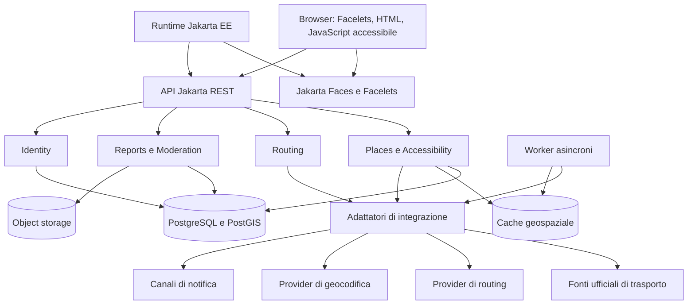

# SDD

## System Design Document

| Dato | Valore |
|---|---|
| Progetto | Aegis — mobilità urbana accessibile |
| Corso | Da compilare |
| Docenti | Da compilare |
| Candidati | Da compilare |
| Anno accademico | Da confermare |

Bozza aggiornata il 16 novembre 2026. L’architettura è iniziale e descrive il sistema proposto; il prodotto non è ancora implementato. Runtime Jakarta EE, fonti dati, area pilota e servizi gestiti sono da convalidare secondo la [roadmap](MILESTONES.md).

## SOMMARIO

| Sezione | Contenuto |
|---|---|
| [Introduzione](#introduzione) | Scopo, obiettivi, definizioni, riferimenti e panoramica |
| [Sistema corrente](#sistema-corrente) | Stato attuale e contesto |
| [Panoramica](#31-panoramica) | Architettura generale |
| [Decomposizione del sistema](#32-decomposizione-del-sistema) | Moduli e responsabilità |
| [Diagramma dei moduli](#321-diagramma-dei-moduli) | Relazioni tra componenti e dipendenze |
| [Hardware/software mapping](#33-hardwaresoftware-mapping) | Nodi e responsabilità |
| [Gestione dei dati persistenti](#34-gestione-dei-dati-persistenti) | [Struttura relazionale](#341-postgresql-e-struttura-relazionale), [object storage](#342-object-storage), [sincronizzazione](#343-meccanismi-di-sincronizzazione) |
| [Controllo accessi e sicurezza](#35-controllo-accessi-e-sicurezza) | [Identità](#351-autenticazione-e-identità), [accesso ai dati](#352-controllo-degli-accessi-ai-dati), [immagini](#353-gestione-delle-immagini), [abusi](#354-protezione-da-abusi) |
| [Flusso di controllo globale](#36-decisioni-sul-flusso-di-controllo-globale) | [Sessione](#361-gestione-della-sessione-utente), [navigazione](#362-navigazione-tra-viste), [asincronia](#363-gestione-asincrona-ed-eventi), [errori](#364-gestione-degli-errori) |
| [Condizioni limite](#37-condizioni-limite) | Identità, luoghi, segnalazioni duplicate, rete, input e geolocalizzazione |
| [Servizi del sottosistema](#servizi-del-sottosistema) | [Identità](#41-autenticazione-utente), [luoghi](#42-gestione-dei-luoghi), [accessibilità](#43-informazioni-di-accessibilità), [percorsi](#44-pianificazione-dei-percorsi), [segnalazioni](#45-segnalazioni-e-moderazione), [geolocalizzazione e aggiornamenti](#46-geolocalizzazione-sincronizzazione-e-notifiche) |
| [Glossario](#glossario) | Termini architetturali e di dominio |

## INTRODUZIONE

### 1.1 SCOPO DEL SISTEMA

Questo documento descrive l’architettura software proposta per Aegis e dettaglia i componenti, i dati, le interfacce e le decisioni operative che realizzano i requisiti definiti nel [RAD](RAD.md).

### 1.2 OBIETTIVI DI PROGETTAZIONE

| Obiettivo | Criterio architetturale |
|---|---|
| Separazione delle responsabilità | Mantenere distinti dominio, casi d’uso e adattatori. |
| Affidabilità dei dati di accessibilità | Registrare fonte e freschezza; trattare i dati assenti o scaduti come sconosciuti. |
| Sostituibilità delle integrazioni | Collegare fonti e provider tramite porte e adattatori. |
| Tracciabilità della moderazione | Conservare gli eventi decisionali in forma append-only. |
| Sicurezza e privacy | Applicare autorizzazione server-side, minimizzazione dei dati e controlli sugli upload. |
| Operatività misurabile | Registrare esiti di sincronizzazione, ritardi delle fonti, errori e stato dei processi asincroni. |

### 1.3 DEFINIZIONI, ACRONIMI E ABBREVIAZIONI

| Termine | Significato |
|---|---|
| API | Interfaccia di programmazione applicativa esposta via HTTP. |
| DTO | Oggetto di trasferimento usato ai confini applicativi. |
| SRID | Identificatore del sistema di riferimento spaziale. |
| PostGIS | Estensione spaziale di PostgreSQL. |
| Jakarta EE | Piattaforma Enterprise Java scelta come base applicativa, versione da convalidare. |
| Jakarta Faces | Tecnologia Jakarta EE per interfacce server-side basate su componenti. |
| Facelets | Tecnologia di viste XHTML usata da Jakarta Faces. |
| Jakarta REST | API Jakarta EE per risorse HTTP REST. |
| Dato sconosciuto | Informazione assente, scaduta o non valida che non permette di determinare l’accessibilità. |

### 1.4 RIFERIMENTI

| Riferimento | Uso e stato |
|---|---|
| [RAD — Documento di Analisi dei Requisiti](RAD.md) | Requisiti, attori, casi d’uso e vincoli. |
| [Template RAD/SDD convertito](template.md) | Struttura accademica di riferimento. |
| Specifica OpenAPI | Da generare e versionare insieme all’API. |
| Documentazione Jakarta EE e PostGIS | Riferimenti tecnici da associare alle versioni selezionate. |

### 1.5 PANORAMICA

Il documento descrive il contesto attuale, l’architettura proposta, la decomposizione dei moduli, la mappatura hardware/software, la persistenza, il controllo accessi, il flusso globale, le condizioni limite e i servizi dei sottosistemi.

## SISTEMA CORRENTE

Non è stato fornito un sistema software esistente. Il progetto è greenfield. Durante la definizione dell’area pilota saranno rilevati i servizi di trasporto esistenti, le fonti dati, i processi di aggiornamento e i flussi di segnalazione già in uso.

## SISTEMA PROPOSTO

### 3.1 PANORAMICA

Aegis è una web app responsive per consultare l’accessibilità di luoghi e servizi di trasporto, pianificare spostamenti e inviare segnalazioni. Le viste server-side usano Jakarta Faces e Facelets; le API REST usano Jakarta REST. La persistenza geografica usa PostgreSQL con PostGIS. Le immagini sono archiviate in object storage e le sincronizzazioni e attività lente sono svolte da worker.

La versione Jakarta EE e il runtime compatibile saranno selezionati in base ai requisiti di distribuzione e alle dipendenze del progetto. La decisione non è ancora convalidata. Provider di routing, fonti di trasporto, canali di notifica e servizi gestiti restano sostituibili e da selezionare.

Il browser riceve HTML per le viste e JSON per le API. La mappa usa una libreria cartografica client-side, ma i dati cartografici e di accessibilità provengono dall’API. La consultazione può essere pubblica; invio delle segnalazioni e moderazione applicano le policy di identità e ruolo ancora da definire.

### 3.2 DECOMPOSIZIONE DEL SISTEMA

La tabella collega i requisiti del [RAD](RAD.md#32-requisiti-funzionali) ai moduli proposti. I riferimenti NFR indicano responsabilità architetturali da verificare, non requisiti già soddisfatti dall’implementazione.

| Modulo | Responsabilità | Requisiti funzionali e casi d’uso | Requisiti di qualità |
|---|---|---|---|
| Places | Gestire luoghi, fermate e stazioni e fornire ricerche geospaziali. | FR-01, FR-06; UC-02 | NFR-08, NFR-11, NFR-14 |
| Accessibility | Gestire caratteristiche, stato, fonte, timestamp e validità. | FR-02, FR-03; UC-01, UC-02 | NFR-08, NFR-14 |
| Routing | Validare richieste, invocare il provider e mostrare l’incertezza dei tratti. | FR-04, FR-05; UC-01 | NFR-11, NFR-14 |
| Reports | Creare segnalazioni e consentire il tracking con dati minimizzati. | FR-07, FR-08; UC-03, UC-04 | NFR-04, NFR-07 |
| Moderation | Applicare autorizzazioni e transizioni; conservare la cronologia append-only. | FR-09; UC-05 | NFR-04, NFR-05, NFR-06 |
| Identity | Gestire autenticazione, ruoli e separazione dei dati identificativi. | FR-13; UC-03, UC-05, UC-06 | NFR-04, NFR-05, NFR-06 |
| Integrations | Implementare adattatori per fonti di trasporto, routing, notifiche e storage. | FR-10, FR-12; UC-03, UC-05, UC-06 | NFR-07, NFR-12, NFR-16 |
| Worker | Eseguire sincronizzazioni schedulate e attività asincrone con retry idempotenti. | FR-10, FR-11, FR-12; UC-06 | NFR-09, NFR-10, NFR-14 |
| Web | Rendere viste Facelets accessibili, mappa, alternative testuali, moduli e pannello di moderazione. | FR-01–FR-09, FR-13; UC-01–UC-05 | NFR-01, NFR-02, NFR-03, NFR-13 |
| Runtime e Operations | Gestire configurazione, distribuzione, osservabilità, migrazioni e ripristino. | Nessun caso d’uso diretto | NFR-05, NFR-09, NFR-10, NFR-12, NFR-15, NFR-16 |

NFR-15 è trasversale: separazione tra dominio, casi d’uso e adattatori e documentazione delle interfacce si applicano a tutti i moduli, non solo a Runtime e Operations.

Il codice Java è organizzato per domini e separa `domain`, `application` e `adapter`. Le entità e i value object contengono invarianti; i casi d’uso orchestrano le operazioni e dipendono da porte; gli adattatori implementano accesso HTTP, persistenza e integrazioni. DTO HTTP, modello di dominio e modello di persistenza sono separati.

La struttura dei package proposta è `places`, `accessibility`, `routing`, `reports`, `identity`, `integrations` e `shared`, ciascuno articolato secondo le responsabilità effettive. La collocazione dettagliata dei componenti web e dei worker dipende dalla selezione del runtime e dal packaging applicativo.

#### 3.2.1 DIAGRAMMA DEI MODULI

Il diagramma mostra il browser e il runtime Jakarta EE, i moduli applicativi, le porte verso le dipendenze sostituibili e i sistemi persistenti.

### 3.3 HARDWARE/SOFTWARE MAPPING

| Nodo | Hardware e software | Responsabilità |
|---|---|---|
| Dispositivo client | Browser desktop o mobile e tecnologie assistive. | Renderizzare le viste, interagire con la mappa e inviare richieste HTTPS. |
| Container applicativo | Runtime Jakarta EE da selezionare; Jakarta Faces, Facelets e Jakarta REST. | Servire viste e API e coordinare i casi d’uso. |
| Container worker | Processo Java compatibile con la piattaforma scelta. | Sincronizzare fonti e gestire attività lente e retry. |
| Database | PostgreSQL con PostGIS. | Conservare entità, eventi e geometrie. |
| Object storage | Servizio compatibile con il protocollo S3; implementazione da selezionare. | Conservare immagini in modo controllato e con scadenza. |
| Ingress e distribuzione | Terminazione TLS e CDN secondo l’ambiente. | Instradare il traffico verso l’applicazione e distribuire risorse statiche. |
| Servizi esterni | Fonti ufficiali, provider di routing e canali di notifica da selezionare. | Fornire dati e capacità integrate tramite adattatori. |

In sviluppo è previsto Docker Compose con PostgreSQL/PostGIS e storage locale compatibile S3. Staging e produzione sono ambienti separati. L’obiettivo di produzione prevede container applicativi gestiti, database con backup automatici, object storage, CDN e gestione centralizzata dei segreti; fornitori, topologia di rete, dimensionamento e obiettivi di ripristino restano da selezionare o concordare.

La pipeline di rilascio dovrà compilare e verificare gli artefatti applicativi, eseguire test e scansioni delle dipendenze, creare immagini versionate e distribuire progressivamente. Le migrazioni devono mantenere la compatibilità con le versioni applicative attive durante il rilascio. La configurazione è versionata e distinta per ambiente; i segreti non sono inclusi nel repository.

### 3.4 GESTIONE DEI DATI PERSISTENTI

La persistenza relazionale usa PostgreSQL e PostGIS. Le migrazioni sono versionate e devono rimanere compatibili con le versioni applicative durante il rilascio progressivo. Le entità di dominio non dipendono dal modello relazionale e sono convertite dagli adattatori di persistenza.

#### 3.4.1 POSTGRESQL E STRUTTURA RELAZIONALE

| Tabella | Contenuto e relazioni |
|---|---|
| `place` | Luogo, fermata o stazione con nome, tipo e geometria a SRID esplicito. |
| `accessibility_feature` | Tipo, stato, fonte, validità e timestamp della caratteristica; riferimento a `place`. |
| `data_source` | Fonte autorizzata, responsabile, configurazione di aggiornamento e regola di validità; schema e modalità di gestione da convalidare. |
| `transit_line` | Linee importate e relativi riferimenti alla fonte. |
| `transit_stop` | Fermate, geometrie e relazioni con le linee e la fonte. |
| `report` | Geometria o luogo, categoria, descrizione, stato e date; dati identificativi separati. |
| `report_event` | Eventi append-only con autore, data, decisione e riferimento a eventuale duplicato. |
| `user_account` | Riferimento d’identità e ruoli con accesso limitato. |
| `source_sync` | Fonte, versione, timestamp, esito e controlli di qualità. |

Le relazioni sono protette da chiavi esterne e vincoli. Le ricerche geografiche usano indici spaziali; ulteriori indici sono definiti in base alle query validate. Le coordinate di dominio sono rappresentate da `GeoPoint`, value object immutabile con controlli di validità.

La politica di backup, la conservazione delle copie e gli obiettivi di ripristino sono da definire con il responsabile operativo. Le procedure di ripristino devono essere provate prima del lancio e dopo modifiche rilevanti all’infrastruttura.

Ogni caratteristica di accessibilità registra fonte, stato, data di aggiornamento e validità. L’assenza o la scadenza produce lo stato sconosciuto. Ogni operazione di moderazione aggiorna lo stato corrente e inserisce l’evento corrispondente nella stessa transazione; gli eventi non sono modificati né eliminati dall’applicazione ordinaria.

#### 3.4.2 OBJECT STORAGE

Le foto sono conservate fuori dal database in object storage. Prima della pubblicazione devono essere verificati tipo effettivo, dimensione e contenuto e deve essere eseguita la scansione prevista. L’accesso è controllato; la conservazione e la scadenza dipendono dalla policy privacy ancora da definire. Il database conserva riferimenti e metadati necessari, non i byte dell’immagine.

#### 3.4.3 MECCANISMI DI SINCRONIZZAZIONE

Worker asincroni importano dati di trasporto e accessibilità tramite adattatori isolati. Ogni esecuzione registra fonte, versione, timestamp, esito e controlli di qualità in `source_sync`. Le operazioni sono idempotenti o usano deduplicazione per gestire retry.

Frequenza e validità sono definite per ciascuna fonte e tipologia durante la selezione dell’area pilota. I dati oltre la validità sono esposti come sconosciuti. Un aggiornamento urgente invalida la cache dell’area interessata e rende osservabile l’esito dell’invalidazione.

### 3.5 CONTROLLO ACCESSI E SICUREZZA

Il controllo accessi è applicato lato server. Le policy di identità per invio, tracking e moderazione, i tempi di conservazione e il consenso delle immagini sono da definire prima del lancio.

#### 3.5.1 AUTENTICAZIONE E IDENTITÀ

La consultazione di luoghi e percorsi è pubblica secondo le policy applicabili. Le funzioni riservate richiedono un’identità autenticata e un ruolo autorizzato. Il provider d’identità e i relativi protocolli non sono ancora selezionati. Le credenziali e i segreti non sono conservati nei log né nel codice applicativo.

#### 3.5.2 CONTROLLO DEGLI ACCESSI AI DATI

Ogni operazione riservata verifica l’autorizzazione sul server. L’accesso ai dati identificativi è separato da quello ai contenuti pubblici delle segnalazioni. Le query sono parametrizzate; input e transizioni di dominio sono validati. Le migrazioni applicano vincoli relazionali e indici necessari all’integrità e alle query autorizzate.

#### 3.5.3 GESTIONE DELLE IMMAGINI

Gli upload sono limitati secondo parametri da definire, verificati per tipo e contenuto, sottoposti a scansione e conservati in storage ad accesso controllato. Un’immagine non verificata non è resa pubblica. Consenso, finalità, durata di conservazione e cancellazione devono essere definiti prima di attivare la pubblicazione.

#### 3.5.4 PROTEZIONE DA ABUSI

Gli endpoint applicano rate limiting e validazione server-side. Le richieste non valide sono rifiutate senza effetti parziali. Gli errori non devono rivelare dati riservati o consentire l’enumerazione delle segnalazioni. I log strutturati escludono credenziali, codici di tracking e descrizioni personali. Le azioni amministrative sono sottoposte ad audit.

### 3.6 DECISIONI SUL FLUSSO DI CONTROLLO GLOBALE

Le viste Facelets e le risorse Jakarta REST costituiscono adattatori. Validano la forma degli input e invocano casi d’uso applicativi. I casi d’uso applicano le regole di dominio, coordinano porte e transazioni e restituiscono risultati tipizzati. Gli adattatori convertono i risultati in viste o DTO HTTP. Le chiamate di rete lente sono eseguite fuori dalle transazioni di database quando possibile.

Le porte applicative includono repository per luoghi e segnalazioni, provider per dati di trasporto e routing, storage e notifiche. Le implementazioni sono selezionabili senza modificare le regole del dominio. OpenAPI documenta le API versionate, gli schemi, gli errori e le regole di accesso.

#### 3.6.1 GESTIONE DELLA SESSIONE UTENTE

La sessione è necessaria solo per le funzioni protette. Il runtime e il meccanismo di identità scelti determineranno durata, rinnovo e terminazione della sessione. La consultazione pubblica non deve dipendere da una sessione autenticata. Le policy di sessione sono da definire insieme al provider d’identità.

#### 3.6.2 NAVIGAZIONE TRA VISTE

Jakarta Faces e Facelets gestiscono la navigazione server-side secondo le convenzioni del runtime selezionato. Le viste previste comprendono ricerca, risultati, mappa con elenco testuale, dettaglio luogo, modulo di segnalazione, tracking e pannello di moderazione. Le transizioni riservate applicano i controlli di autorizzazione; i flussi mantengono etichette, focus e annunci accessibili.

Le API REST sono versionate e separate dal contratto delle viste. Un client cartografico riceve dati dall’API e offre una rappresentazione testuale equivalente.

#### 3.6.3 GESTIONE ASINCRONA ED EVENTI

Le sincronizzazioni e le attività lente sono eseguite da worker. Le notifiche sono inviate tramite `NotificationPort` dopo il completamento del caso d’uso, con retry e deduplicazione da definire. Gli aggiornamenti urgenti invalidano la cache geograficamente coinvolta. Le chiamate a provider esterni non mantengono aperte transazioni database quando non necessario. Metriche e allarmi devono rendere osservabili disponibilità, latenza, ritardo delle fonti, errori di sincronizzazione e dimensione e anzianità della coda di moderazione; soglie e obiettivi di servizio sono da concordare.

#### 3.6.4 GESTIONE DEGLI ERRORI

Gli errori sono convertiti in una forma HTTP uniforme e in messaggi comprensibili per l’interfaccia. I dettagli interni e i dati personali non sono restituiti al client né registrati nei log. Ogni caso d’uso garantisce le proprie condizioni transazionali: un errore di moderazione non lascia divergenze tra stato e cronologia; un errore di creazione non lascia una segnalazione parziale. Le viste espongono in modo accessibile stati di caricamento, assenza di risultati ed errore.

La procedura operativa per gli incidenti deve definire rilevazione, escalation, contenimento, ripristino, comunicazioni e registrazione degli esiti prima dell’apertura del servizio.

### 3.7 CONDIZIONI LIMITE

#### 3.7.1 UTENTE NON AUTENTICATO

La consultazione pubblica di luoghi e percorsi resta disponibile. Se un utente non autenticato richiede un’operazione protetta, il sistema rifiuta l’operazione e comunica come accedere alla funzione secondo la policy di identità da definire. L’autorizzazione è verificata lato server.

#### 3.7.2 LUOGO NON TROVATO O IDENTIFICATIVO NON VALIDO

Se un identificativo non corrisponde a un luogo, il sistema restituisce un esito coerente senza dati parziali. Se il luogo esiste ma i dati di accessibilità sono assenti, scaduti o incoerenti, li presenta come sconosciuti e non li usa come prova di compatibilità.

#### 3.7.3 SEGNALAZIONI DUPLICATE

Una segnalazione che descrive un caso già registrato può essere unita al report esistente solo tramite una decisione autorizzata di moderazione. Il sistema conserva entrambe le segnalazioni e registra l’unione nello storico; non crea una relazione duplicata né sovrascrive eventi precedenti.

#### 3.7.4 INVII RIPETUTI E DUPLICAZIONE DEI DATI IMPORTATI

Retry della creazione e sincronizzazioni ripetute non devono creare segnalazioni o dati di trasporto duplicati. Il sistema usa idempotenza o deduplicazione e rende osservabile l’esito. Un codice di tracking inesistente o non valido non permette di enumerare segnalazioni.

#### 3.7.5 CARICAMENTO LENTO O ASSENZA DI RETE

Le viste mostrano stati di caricamento e un errore accessibile quando rete, API o provider di routing non rispondono. Un fallback di percorso è marcato come non verificato. Se non esistono percorsi compatibili, il sistema comunica l’esito esplicitamente e presenta eventuali alternative con tratti non verificati.

#### 3.7.6 INPUT INCOMPLETI O INVALIDI

Richieste di percorso, moduli e identificativi sono validati prima di produrre effetti. In caso di input incompleto o non valido il sistema restituisce errori comprensibili e non persiste modifiche parziali. Un upload non valido o con scansione fallita viene rifiutato o messo in quarantena e non è reso pubblico.

#### 3.7.7 PERMESSI DI GEOLOCALIZZAZIONE NEGATI

Se la persona nega il permesso di geolocalizzazione, il sistema non blocca ricerca e pianificazione. L’interfaccia consente di inserire manualmente origine, destinazione o luogo e non conserva la posizione oltre quanto necessario alla richiesta.

## SERVIZI DEL SOTTOSISTEMA

### 4.1 AUTENTICAZIONE UTENTE

Il sottosistema Identity verifica l’identità e i ruoli necessari per invio, tracking e moderazione. Provider e protocollo di autenticazione sono da selezionare. La consultazione pubblica non richiede una sessione autenticata. I dati identificativi restano separati dai contenuti pubblici delle segnalazioni.

### 4.2 GESTIONE DEI LUOGHI

Il sottosistema Places importa e consulta luoghi, fermate e stazioni. Le query geospaziali usano PostGIS e restituiscono geometrie e identificativi secondo il contratto API. La ricerca e il dettaglio sono in sola lettura per i dati ufficiali; gli aggiornamenti arrivano dagli adattatori delle fonti autorizzate.

### 4.3 INFORMAZIONI DI ACCESSIBILITÀ

Il sottosistema Accessibility recupera le caratteristiche associate ai luoghi e valuta validità e provenienza. Ogni risposta include stato, fonte e freschezza disponibili; dato assente o scaduto è classificato sconosciuto. Le informazioni sono fornite ai dettagli dei luoghi e ai casi d’uso di pianificazione.

### 4.4 PIANIFICAZIONE DEI PERCORSI

Il caso d’uso `PlanRoute` valida origine, destinazione e vincoli, invoca `RoutingProvider` e combina il risultato con le informazioni di accessibilità. Dati affidabili e compatibili possono essere usati per escludere tratti; dati incerti sono mostrati come tali. Il servizio non modifica lo stato persistente di dominio.

### 4.5 SEGNALAZIONI E MODERAZIONE

`CreateReport` valida i dati, gestisce l’eventuale upload attraverso il flusso di scansione e persiste segnalazione ed evento iniziale in modo atomico. `TrackReport` restituisce soltanto lo stato consentito al possessore del codice. `ModerateReport` verifica identità, ruolo, esistenza del report e transizione ammessa; aggiorna lo stato e aggiunge un evento append-only nella stessa transazione. Conferma, rifiuto, risoluzione e unione dei duplicati devono essere rappresentati dalla macchina a stati di dominio da definire. I dettagli identificativi sono esclusi dalla risposta pubblica.

### 4.6 GEOLOCALIZZAZIONE, SINCRONIZZAZIONE E NOTIFICHE

La ricerca consente di usare coordinate quando disponibili e un inserimento testuale alternativo quando la persona nega la geolocalizzazione. Worker e `TransitDataProvider` importano fonti ufficiali, eseguono controlli di qualità e registrano versione, timestamp ed esito. `NotificationPort` inoltra notifiche in modo asincrono secondo autorizzazioni e consensi. Provider di geocodifica, fonti, frequenze, canali, retry e livelli di servizio sono da selezionare e convalidare.

## GLOSSARIO

| Termine | Definizione |
|---|---|
| Adattatore | Componente che collega una porta applicativa a un sistema esterno o a un dettaglio tecnico. |
| Dato sconosciuto | Dato assente, scaduto o non valido che non consente di determinare l’accessibilità. |
| DataSource | Fonte autorizzata con responsabile e regole di aggiornamento e validità. |
| DTO | Oggetto di trasferimento usato ai confini applicativi e distinto dal modello di dominio. |
| Facelets | Tecnologia di viste XHTML usata da Jakarta Faces. |
| Feature di accessibilità | Caratteristica dichiarata di un luogo, corredata di stato e provenienza. |
| GeoPoint | Value object immutabile per coordinate valide con riferimento spaziale esplicito. |
| Jakarta EE | Piattaforma Enterprise Java di riferimento per runtime, API web e servizi applicativi. |
| Jakarta Faces | API Jakarta EE per viste server-side basate su componenti. |
| Jakarta REST | API Jakarta EE per l’esposizione di risorse HTTP. |
| NotificationPort | Porta applicativa per l’invio di notifiche tramite un adattatore sostituibile. |
| Porta | Interfaccia applicativa che descrive una dipendenza richiesta da un caso d’uso. |
| PostGIS | Estensione PostgreSQL per dati e interrogazioni geospaziali. |
| ReportEvent | Evento immutabile che registra una transizione o decisione su una segnalazione. |
| RoutingProvider | Porta verso il servizio che calcola alternative di percorso. |
| SourceSync | Registrazione dell’esito, della versione e dei controlli di una sincronizzazione. |
| SRID | Identificatore del riferimento spaziale di una geometria. |
| Tracking code | Codice non enumerabile usato per consultare lo stato consentito di una segnalazione. |
| TransitDataProvider | Porta verso una fonte di dati di trasporto. |
| Value object | Oggetto immutabile definito dal valore e dalle proprie invarianti. |
| Worker | Processo asincrono che esegue sincronizzazioni o attività lente fuori dalle richieste interattive. |
